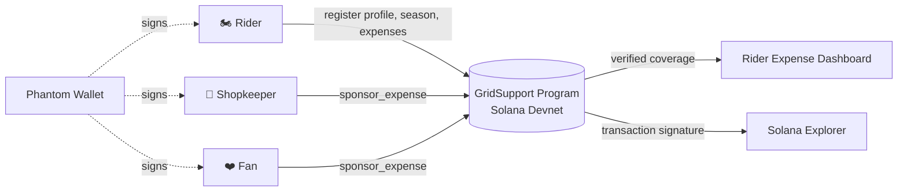

<div align="center">

# 🏁 GridSupport

### Talent should decide who gets to race. Not just money.

Micro-sponsorship for grassroots motorsport, with every commitment recorded on Solana.


[**View GridSupport Smart Contract on Solana Devnet**](https://explorer.solana.com/address/H98fSKptEE9rVR11K75GY5xdUkDk8bEGYsyjuosX9wVQ?cluster=devnet)

</div>

---

## 📌 Table of Contents

- [The Problem](#-the-problem)
- [The Solution](#-the-solution)
- [How It Works](#-how-it-works)
- [Architecture](#-architecture)
- [Implementation Status](#-implementation-status)
- [Tech Stack](#-tech-stack)
- [Getting Started](#-getting-started)
- [Scope and Limitations](#-scope-and-limitations)
- [Roadmap](#-roadmap)
- [Why I'm Building This](#-why-im-building-this)

---

## 🚧 The Problem

A talented rider can put in years of practice, improve lap after lap, and still struggle to reach the next race weekend. Tyres, fuel, travel, accommodation, and repairs all cost money. For riders without major backing, these everyday expenses can be the difference between staying on the grid and walking away.

Traditional sponsorship depends on connections, visibility, and the ability to land a large sponsor. Riders who are still building their careers rarely have any of these.

## 💡 The Solution

GridSupport breaks a rider's racing budget into **clear, individual expenses** that nearby businesses and fans can discover and back.

> *What if a local business or fan could help with just one part of a rider's next race?*

- A **tyre shop** covers tyres.
- A **local business** contributes toward accommodation.
- A **fan** picks an expense and sponsors a small part of it.

Every verified commitment is recorded on Solana and updates the remaining amount needed for that expense. The goal is not to replace major sponsors. It is to open another path for riders who are still building their careers.

---

## 🔄 How It Works

| Role | What they do |
| --- | --- |
| 🏍️ **Rider** | Connects Phantom, registers a profile and racing season, and lists expenses such as tyres, fuel, and accommodation. The Expense Dashboard shows the required amount, verified coverage, and what remains. |
| 🏪 **Shopkeeper** | Discovers a registered rider, selects an expense, and makes an in-kind sponsorship commitment. The action is signed with Phantom and submitted to the GridSupport program on Devnet. Once confirmed, the UI links to the transaction and updates coverage. |
| ❤️ **Fan** | Discovers a rider and sponsors a specific expense. In the current demo, this uses the same on-chain `sponsor_expense` instruction as the Shopkeeper flow. |
| 🎉 **Community Effect** |When the whole community supports the rider , then the magic happens and the rider rides without the tension of funding. |

## 🏗️ Architecture



The frontend only marks a sponsorship as successful after the transaction is confirmed **and** the updated coverage is read back from chain. Verified on-chain data is kept strictly separate from illustrative storytelling.

---

## ✅ Implementation Status

| Feature | Status |
| --- | :---: |
| Phantom wallet connection and Devnet integration | ✅ |
| On-chain rider registration and season creation | ✅ |
| Expense creation and verified expense tracking | ✅ |
| Rider discovery for supporters | ✅ |
| Shopkeeper sponsorships via `sponsor_expense` | ✅ |
| Fan expense sponsorships via the same instruction | ✅ |
| Transaction confirmation and Solana Explorer links | ✅ |
| Rider dashboard with verified and remaining amounts | ✅ |
| Community Effect animation and victory video | ✅ (off-chain, illustrative) |
| Distinct on-chain Fan role | 🔜 |
| Token / cash contributions | 🔜 |

## 🛠️ Tech Stack

| Layer | Technology |
| --- | --- |
| Frontend | React, TypeScript, Vite |
| Smart contracts | Rust, Anchor |
| Blockchain | Solana Devnet |
| Wallet | Phantom |
| RPC | Chainstack Devnet endpoint |

## 🔗 Deployed Program

| | |
| --- | --- |
| **Network** | Solana Devnet |
| **Program ID** | `H98fSKptEE9rVR11K75GY5xdUkDk8bEGYsyjuosX9wVQ` |
| **Explorer** | [View GridSupport Smart Contract on Solana Devnet](https://explorer.solana.com/address/H98fSKptEE9rVR11K75GY5xdUkDk8bEGYsyjuosX9wVQ?cluster=devnet) |

---

## 🚀 Getting Started

### Prerequisites

- Node.js 18+ and npm
- [Phantom wallet](https://phantom.app/) set to **Devnet**
- Devnet SOL for transaction fees

### Run locally

```bash
git clone https://github.com/Debagithub567/GridFund.git
cd GridFund/gridsupport/frontend
npm install
```

Create your local environment file using `frontend/.env.example` as a reference. Keep RPC credentials in local env files and never commit them.

```bash
npm run dev
```

Open the URL printed by Vite (typically `http://localhost:5173`), connect Phantom on Devnet, and explore the Rider, Shopkeeper, and Fan workspaces.

> **Note:** Registration and sponsorship actions require wallet approval and Devnet connectivity. The frontend uses an already-deployed program, so you do **not** need to redeploy the smart contract to run it.

---

## ⚖️ Scope and Limitations

GridSupport currently demonstrates **on-chain expense sponsorship commitments**. It is not a production sponsorship marketplace.

- The Shopkeeper and Fan paths use the same generic sponsorship instruction. The program does not identify the signer as a distinct Fan category.
- The Fan flow does **not** send a cash donation or transfer gsUSDC in the current interface.
- The Community Effect finale is illustrative. It creates no transactions and is not evidence that a rider's expenses have been funded.
- Real-world fulfillment, sponsor verification, and production-grade identity and dispute handling would need additional work before real deployment.

## 🗺️ Roadmap

- [ ] Distinct on-chain roles for Shopkeepers and Fans
- [ ] Token-based contributions for fan sponsorship
- [ ] Sponsor verification and in-kind fulfillment tracking
- [ ] Identity and dispute handling
- [ ] Mainnet readiness review

## ❤️ Why I'm Building This

Motorsport is full of people willing to put in the work who don't have equal access to the resources needed to keep competing. I wanted to explore whether software could make support more practical: smaller commitments, clearer needs, and a record everyone involved can inspect.

GridSupport is a first step. It is intentionally focused on the moment a rider needs help getting to the next race, not on pretending to solve the economics of motorsport overnight.

---

<div align="center">

**Built for riders who deserve a shot at the starting grid.** 🏁

</div>
